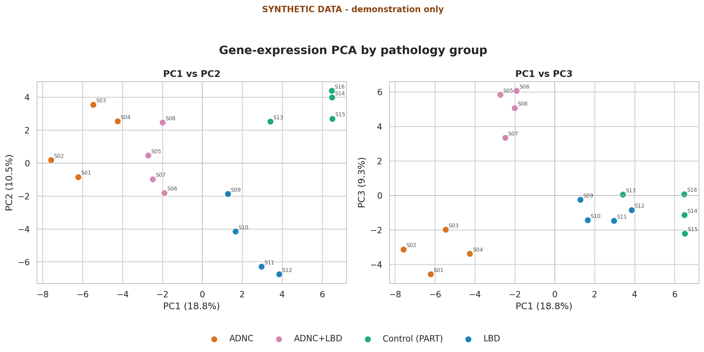

# Iso-Seq expression analysis

Exploratory analysis of gene expression from Iso-Seq brain samples. This started with a PCA notebook and adds sample QC, gene loadings, metadata comparisons, and checks for possible batch effects.

The input is gene-level expression. It does not contain the transcript-level data needed to study isoform switching.

## Run the example

The included dataset is synthetic. It demonstrates the code; its plots are not research findings.

```bash
python -m pip install -e .
python scripts/generate_demo_data.py
python run_analysis.py \
  --expression data/demo/Gene_expression.tsv \
  --clinical data/demo/clinical_info.csv \
  --output demo_output \
  --top-genes 300 --permutations 199 --synthetic
```



Outputs go into `figures/`, `results/`, and `docs/RESULTS.md` under the output directory. They include QC plots, PCA, gene rankings, metadata associations, and a comparison of different gene-selection cutoffs.

## Research data

The original expression and clinical files are not included. With authorized copies in `data/raw/`:

```bash
python run_analysis.py \
  --expression data/raw/Gene_expression.tsv \
  --clinical data/raw/clinical_info.csv
```

Research inputs and default outputs are ignored by Git. Renaming sample IDs does not make clinical data anonymous; derived figures also need approval before publication.

## Notes

The analysis is exploratory. Correlations with RNA quality do not establish causation, and a nonsignificant test does not rule out disease effects. Batch labels are inferred from report identifiers and need confirmation.

See [methods](docs/METHODS.md) for statistical choices and limitations, and [input format](data/README.md) for the file schema.

## Code

- `io.py`: load and validate the tables
- `preprocess.py`: QC, filtering, and PCA
- `stats.py`: group comparisons and sensitivity checks
- `plots.py`: figures
- `pipeline.py`: run the analysis and write results

```bash
python -m unittest discover -s tests -v
```
